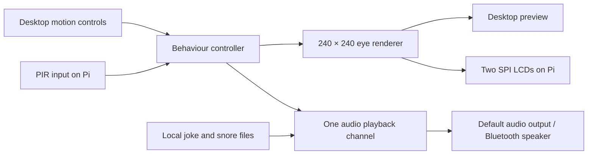
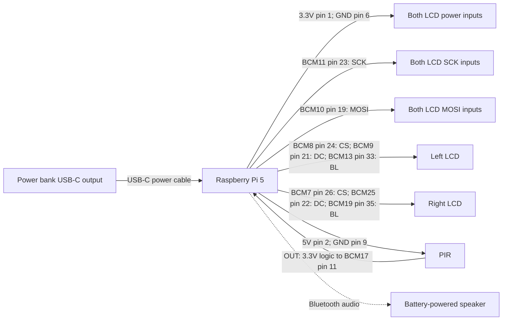

# Playful Halloween pumpkin

Initial build plan, 25 October 2026. No Spec Kitty workflow is used.

## Intended experience

A friendly pumpkin sleeps with gently moving closed eyelids. Movement wakes it with a slow eye opening, a curious glance, and a randomly selected Halloween joke. It blinks naturally while awake. After the motion input has been inactive for 20 seconds, it returns to sleep. Quiet, occasional snores are optional and stop immediately when it wakes.

Keep the personality silly: rounded green or amber irises, large pupils, soft highlights, relaxed lids, no sharp teeth or startling sound effects. Start at low volume and use short audio fades.

Confirmed choices:

- First test on the Mac, with no electronics attached.
- One joke per wake cycle, with no immediate repeat of the previous joke.
- Friendly British voice, with speech generated and saved ahead of time.
- Offline operation on the night; no API credentials needed on the Pi.
- Enclosed porch installation, aiming for 3–4 hours between charges. The Pi has a cooled case and accessible GPIO.
- Closed eyes remain visible during sleep. Sleep is an application state, not Pi suspend or removal of display power.

## Software design

Use a Python application, with a pygame desktop preview and Pillow-generated 240×240 RGB frames. Hardware dependencies are optional and imported only in Pi mode. Both environments use the same state machine and eye renderer.

Suggested modules:

| Module | Responsibility |
| --- | --- |
| `controller` | Wake/sleep rules, visit state, joke selection, timing |
| `eyes` | Procedural eye artwork, gaze, blink and sleep animation |
| `motion` | Simulated input or Pi PIR input |
| `display` | Desktop window or pair of ST7789 LCD outputs |
| `audio` | Nonblocking clip playback, stop/fade, missing-file handling |
| `config` | Timing, colours, volume, pin mappings, hardware mode |
| `prepare_audio` | Optional, separate speech generation before deployment |

Use a monotonic clock. Keep rendering and motion processing running during speech; audio playback must never block the animation loop. Shut down audio, backlights, SPI and GPIO cleanly when exiting.

### Behaviour rules

1. At startup, show sleeping eyes. In hardware mode allow an initial PIR stabilisation period, provisionally 60 seconds, before accepting triggers.
2. When motion is active, begin opening the eyes and start one randomly selected local joke after a short greeting pause. Cancel any snore immediately.
3. While the PIR remains high, continually refresh the activity timestamp. Further triggers extend the visit but do not queue more jokes.
4. After 20 continuous seconds of inactive PIR input, fade any remaining audio, close the eyes, and re-arm the next visit.
5. Motion during the sleep transition immediately wakes the pumpkin again. Motion while already awake does not restart the joke.
6. Choose a fresh blink interval, roughly 3–6 seconds, after each blink. Small glances and a gentle eyelid bob during sleep add personality.
7. Optional snoring plays infrequently, for example every 45–90 seconds of uninterrupted sleep, with no overlapping audio.

A PIR measures changes in infrared, not occupancy. A visitor standing still may not keep the pumpkin awake. The 20-second software timer starts after the sensor's output becomes inactive, so the sensor's physical hold time adds to the delay after actual movement. Set its delay near minimum and try its retrigger mode during bench testing. Tune sensitivity to the approach path, avoiding passing traffic where possible. [PIR specifications](https://shop.pimoroni.com/products/pir-motion-sensor).

## Eye artwork and audio

Generate the eyes procedurally rather than depending on GIF assets. This makes both eyes coherent, allows changes to colour and gaze, and gives smooth transitions at the exact display resolution. Export sample PNGs or a GIF for reviewing the style. This is code-generated artwork and needs no image-generation service.

Start with 10–15 curated, child-friendly jokes, stored as text alongside stable clip identifiers. Example: “Why did the skeleton stay home? He had no body to go with!” Keep the script fixed and select locally, so there is no unpredictable live content.

The first prototype can use the Mac's installed speech voice. For better character, provide a separate tool to synthesise the approved scripts into local WAV clips using the chosen provider. Record the provider, voice and generation settings in an asset manifest. Split setup and punchline clips if we want reliable pauses and eye reactions without speech-mark alignment. An optional generated soft snore should be reviewed before use.

Bluetooth adds playback latency, so v1 animates a playful talking expression for the duration of the clip rather than attempting exact lip sync. Test the speaker for automatic sleep, clipped first syllables and reconnection after long idle periods. If necessary, add a short silent lead-in and verify that it helps on this particular speaker; do not assume silence prevents speaker auto-sleep.

## Wiring for the final installation

This is a proposed **direct-wired configuration with the Breakout Garden removed**. BCM numbers identify GPIO signals; physical numbers identify positions on the Pi's 40-pin header. Connect using the printed labels on the breakouts, not their apparent left-to-right orientation. Power off before changing wiring.

The two screens share clock and MOSI and have different chip selects. For the direct-wired version, use separate data/command pins as shown, avoiding shared GPIO ownership in the display library. This deliberately differs from the HAT configuration.

| Connection | Pi BCM / supply | Physical pin | Destination |
| --- | --- | --- | --- |
| LCD power | 3.3V supply | 1 | Both LCD `3–5V` inputs |
| LCD ground | GND | 6 | Both LCD `GND` inputs |
| SPI clock | GPIO11 / SCLK | 23 | Both LCD `SCK` |
| SPI data | GPIO10 / MOSI | 19 | Both LCD `MOSI` |
| Left select | GPIO8 / CE0 | 24 | Left LCD `CS` |
| Right select | GPIO7 / CE1 | 26 | Right LCD `CS` |
| Left command/data | GPIO9 | 21 | Left LCD `DC` |
| Right command/data | GPIO25 | 22 | Right LCD `DC` |
| Left backlight | GPIO13 | 33 | Left LCD `BL` |
| Right backlight | GPIO19 | 35 | Right LCD `BL` |
| PIR power | 5V supply | 2 | PIR `VCC` |
| PIR ground | GND | 9 | PIR `GND` |
| PIR signal | GPIO17 | 11 | PIR `OUT` |

All grounds are electrically common. The LCDs do not need MISO; GPIO9 is intentionally used as a DC output, following Pimoroni's wiring convention. Enable SPI0 and leave MISO unconnected. There is no external reset wire in this seven-pin display interface. The speaker uses its own battery, with no GPIO audio wiring.

Pimoroni specifies 3.3V/5V supply compatibility for these LCD breakouts and documents their signal labels. The second chip select and separate right-eye DC pin are our configuration choices. [LCD wiring reference](https://shop.pimoroni.com/products/1-3-spi-colour-lcd-240x240-breakout).

The specified PIR needs a 4.8–20V supply and provides 3.3V/0V logic, so use 5V for its supply and connect its OUT directly to the Pi input. Verify the labels on the actual module. Do not put 5V onto a Pi GPIO signal pin. [PIR pinout and electrical specifications](https://shop.pimoroni.com/products/pir-motion-sensor).

Keep SPI leads short, initially around 10–15 cm. Start conservatively at 8 MHz, with a target of 15–20 frames per second for the pair, then measure on the assembled hardware. Reduce speed if longer wiring causes corruption. Provide secure connectors and strain relief for the final assembly; loose breadboard jumpers are suitable for bench tests.

### Breakout Garden bench configuration

Fit the HAT with the Pi powered off, then insert one LCD in each seven-contact SPI slot, matching the printed labels. Do not use the five-contact I2C slots. The HAT supports two SPI breakouts. Check clearance above any Pi 5 cooler and use suitable standoffs. [HAT reference](https://shop.pimoroni.com/products/breakout-garden-hat-i2c-spi).

Use a separate `garden` display configuration based on its schematic: CE0 and CE1 select the two displays, and the DC connection is shared. Share a single requested GPIO line handle between driver instances and update the displays serially; asking the modern GPIO library to request that same line twice can fail. Confirm the per-slot backlight mapping from the schematic during the hardware adapter implementation. The direct wiring table above must not be applied to screens already connected through the HAT. [PIM445 schematic](https://cdn.shopify.com/s/files/1/0174/1800/files/breakout_hat_spi_PIM445.pdf?v=1621325469).

GPIO17 remains our intended PIR input, but the HAT's extension header does not expose every Pi pin. Check access before fitting it; use a suitable stacking header or GPIO splitter if needed. Test simulated motion on the Pi first if the PIR connection is awkward.

## Raspberry Pi software and deployment

Use a current 64-bit Raspberry Pi OS image and a project virtual environment. Enable SPI. Use the current Pimoroni ST7789 driver, whose source uses `gpiod`/`gpiodevice`, rather than following the older RPi.GPIO installation commands in its README. Confirm and lock a Pi-tested release during the hardware phase. [Driver source](https://github.com/pimoroni/st7789-python/blob/main/st7789/__init__.py).

For the PIR, use GPIO Zero with its `lgpio` backend, which supports Pi 5. Avoid hard-coding a gpiochip number: identify the controller on the actual OS image. [GPIO Zero pin backend documentation](https://gpiozero.readthedocs.io/en/stable/api_pins.html).

First run interactively with the speaker paired and selected as the audio output. Then create a user service that starts with the user's audio session, restarts on failure and writes bounded logs. Verify startup after a complete power cycle without a monitor, including Bluetooth reconnection. If using a headless user service, configure lingering and confirm the audio service and Bluetooth policy operate in that session.

Use GitHub Actions for state-machine tests, configuration validation and a desktop render smoke test. Keep hardware testing manual. Deploy a tested commit/tag by pulling on the Pi over the home network; retain the previous known-good version. There is no need to expose the Pi to the internet or set up unattended deployment for v1.

## Credentials

The running pumpkin should need no API key when using prepared audio. Keep any generation key in a local environment variable or an ignored `.env` file with permissions restricted to the owner. The existing `.gitignore` excludes `.env` files. Commit only a placeholder `.env.example`, never real keys. Do not put secrets in configuration examples, audio metadata, logs or the preview UI. If audio generation later runs in GitHub Actions, use GitHub Actions secrets; ordinary tests should not need credentials.

## Power and physical installation

The owner's label photograph confirms a UGREEN PB773 with USB-C output at **5V/3A (15W)**. Its higher-voltage modes do not provide extra power to the Pi at 5V. This meets Pi 5's documented baseline supply rating, so it is a reasonable candidate for bench testing this light workload, although it does not provide the recommended 5V/5A headroom. With a 3A supply, the Pi limits downstream USB current to 600mA; a power-supply warning is expected. Leave that limit in place. The LCDs use GPIO-header power, so their demand still counts towards the overall supply budget. [Raspberry Pi power documentation](https://www.raspberrypi.com/documentation/computers/raspberry-pi.html#power-supply).

Use one wired USB-C output for the Pi, leave wireless charging off, and run the speaker from its own battery. The label lists reduced combined output when charging multiple devices, so do not charge the speaker or a phone from the bank during operation. Check for undervoltage and resets with the complete assembly before relying on it.

The label shows 36Wh internal battery energy and appears to specify 5800mAh rated output capacity at 5V, equivalent to approximately **29Wh delivered** under its stated test conditions. Use that delivered figure for a rough runtime budget without subtracting conversion losses a second time. For illustration, 29Wh supports about 4.1 hours at 7W average, 3.2 hours at 9W, or 2.4 hours at 12W. These are calculations, not measured pumpkin power consumption; cable losses, temperature, battery age and shutdown reserve affect real endurance. The 3–4 hour goal is plausible if average demand stays around 7–9W, but needs a full rehearsal.

Battery endurance must be measured with both screens, cooler, Bluetooth and animation running. The advertised mAh usually describes the internal cells rather than usable capacity at USB voltage. Record bank watt-hours, do a realistic run, and check `vcgencmd get_throttled` for power or thermal trouble. The sleeping animation saves little Pi power; the Pi remains running. Check whether the speaker has enough battery for the same period, and shut the Pi down cleanly before removing power.

Keep electronics and battery in a dry, ventilated enclosure separated from pumpkin flesh, drips and condensation. Mount screens behind the eye openings and expose the PIR lens through its own opening; do not put ordinary glass or a plastic weather window in front of the lens without testing detection. Keep cooler airflow unobstructed. Use battery LED lighting if desired; no flame near electronics. Final weather protection depends on whether the pumpkin sits indoors, under cover or in rain.

## Delivery phases and acceptance checks

1. **Desktop prototype:** two rendered eyes, simulated motion pulse and held-high controls, visible state/timer, random joke captions, local speech and mute. Check repeated motion, uninterrupted animation during speech, 20-second inactivity, long high input, wake during closing, no overlapping audio and orderly exit.
2. **Asset review:** approve eye colours and expressions, joke scripts, voice, volume and optional snores. Export a visual preview and generate all chosen audio. Confirm an offline run with no API key.
3. **Pi bench test:** one screen first, then two independently labelled screens through the Garden; verify colour, rotation and distinct eye positions. Add PIR after warmup and check its hardware delay. Verify Pi-compatible GPIO, frame rate and Bluetooth idle/reconnect behaviour.
4. **Final assembly:** replace the Garden with the documented harness, choose the direct-wired configuration, verify each wire with power off, and repeat the bench checks. Test the intended battery for the full required duration plus a practical margin.
5. **Doorstep rehearsal:** test approaching from actual directions, a visitor standing still, consecutive groups, ambient temperature, volume at child height, enclosure placement, cold boot and clean shutdown. Record a known-good deployment tag.

## Current delivery status

The Mac prototype is implemented with procedural eyes, simulated motion, the 20-second inactivity rule, one joke per visit, prepared Daniel British speech, captions, mute and optional quiet snores. See README.md for commands and verification.

Pi adapters, final speech character selection, the auto-start service and physical verification remain subsequent phases. The bank's 5V/3A output is now confirmed from the owner's label photograph. Verify stable power and battery endurance against the agreed 3–4 hour requirement.

This is a build plan, not a claim that physical wiring has been tested. Hardware adapter details must be verified on the actual Pi before final assembly.
