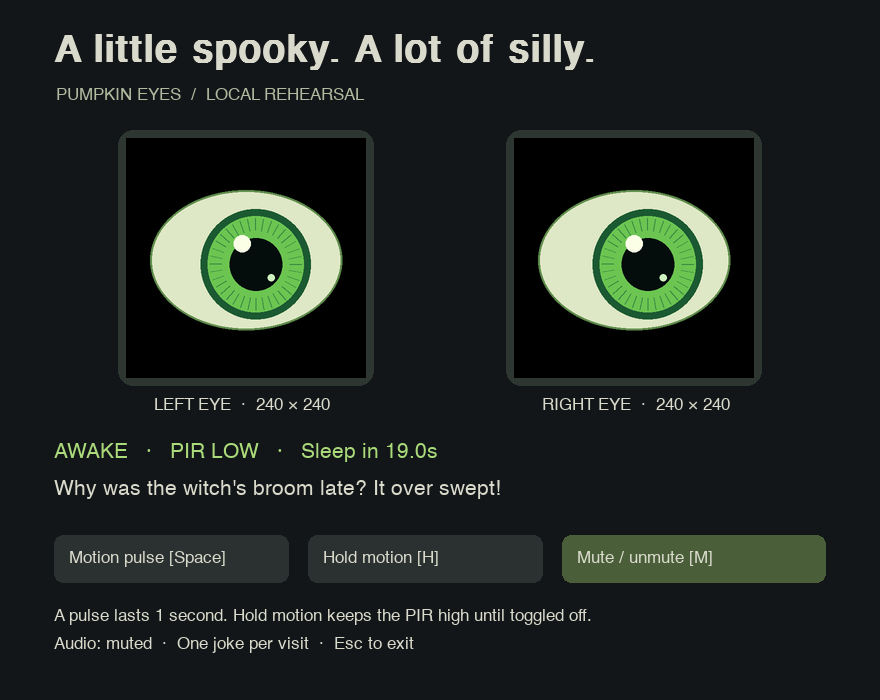

# Pumpkin Eyes 🎃

A friendly pumpkin with blinking eyes and terrible jokes. This first version runs on a Mac with simulated motion, original code-generated eye artwork and prepared British speech. It operates offline and needs no API key.



## Try it on the Mac

Python 3.14 is the tested version. From this project directory:

```sh
python3.14 -m venv .venv
source .venv/bin/activate
python -m pip install -r requirements.txt
python -m pumpkin
```

The environment and audio files have already been prepared in this checkout, so you can also run:

```sh
.venv/bin/python -m pumpkin
```

- **Space** or **Motion pulse**: simulate one second of motion.
- **H** or **Hold motion**: toggle a continuously high PIR signal.
- **M**: mute/unmute. **Esc**: quit.
- After motion ends, the pumpkin stays awake for 20 seconds, then gently closes its eyes.
- Each wake cycle plays one random joke. More motion extends that visit without another joke.

The first audio is deliberately quiet. Select the Mac or paired speaker as your normal sound output. Captions work even if the audio device is unavailable.

Useful options:

```sh
python -m pumpkin --sleep-after 5   # quicker rehearsal
python -m pumpkin --snores          # occasional quiet snores while sleeping
python -m pumpkin --mute            # visual-only rehearsal
```

## Speech and artwork

The renderer produces a separate 240×240 frame for each eye. Blinking, glancing and gentle sleeping movement are generated in code; there are no external image assets to obtain.

Ten jokes and a soft procedural snore are included under `assets/audio/`. The jokes use macOS's installed **Daniel** British voice. Regenerate them on the Mac after changing `pumpkin/jokes.json`:

```sh
python tools/prepare_audio.py
```

The generation script validates that speech is nonempty. If it reports sandbox restrictions or an unavailable voice, run it in your normal Mac terminal and check **System Settings → Accessibility → Read & Speak** for installed voices. `say -v '?'` lists installed voices; use `--voice 'voice name'` to select one.

For a richer character, we can replace these WAV files with approved AI speech later. Match the existing clip names; mono 22,050 Hz PCM WAV is the preparation format. The running pumpkin never contacts a speech service. `assets/audio/manifest.json` records the current scripts and voice settings.

## Raspberry Pi build

Read [the build plan and wiring diagram](PLAN.md) before connecting hardware. It covers the Breakout Garden bench stage, a separate final wiring configuration, PIR timing, Bluetooth, battery testing, secure credentials and deployment.

**This version is the desktop prototype. The Pi display/PIR adapters and automatic-start service are planned, not implemented or hardware-tested yet.** No Pi hardware libraries are installed by the desktop requirements.

The agreed physical target is an enclosed porch, 3–4 hours between charges, with the Pi already in a cooled case and accessible GPIO. The power bank's label confirms 5V/3A USB-C output, making it a candidate for bench testing. Stable power and endurance still need verification on the actual assembly. Power only the Pi from the bank and use the speaker's own battery; see the plan for the power budget.

The existing ignore rules exclude `.env` files. Keep any future speech-generation key in a local environment variable or ignored `.env`; never put it in source or a committed config file. Prepared audio needs no key on the Pi.

## Verification

```sh
python -m unittest discover -s tests -v
SDL_VIDEODRIVER=dummy SDL_AUDIODRIVER=dummy python -m pumpkin --demo --seconds 2
```

GitHub Actions repeats these checks on pushes and pull requests. Deployment to the Pi remains a deliberate pull of a known-good commit; no cloud hosting or public network access is needed.
